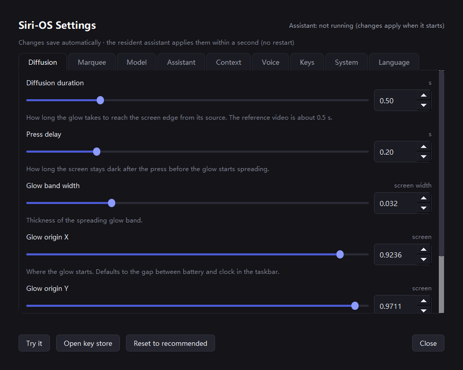

# Siri-OS · a desktop recreation of the **first** Apple Intelligence glow

> A Windows desktop voice assistant that recreates the *first-generation* Apple Intelligence
> interface (iOS 18 / macOS Sequoia, 2024): a **diffuse iridescent rim that erupts radially from
> the key you pressed**, a caption card at the top of the screen, and a full-screen
> click-through overlay.


<sub>Left to right: the 200 ms delay - the rim is still completely dark - then the
wavefront mid-flight, then the settled rim with its bright head running the perimeter.</sub>

<sub>Not affiliated with, endorsed by, or connected to Apple. "Apple Intelligence" and Siri are
trademarks of Apple Inc. This is an independent homage built by reverse-engineering a screen
recording.</sub>

---

## What it does

| | |
|---|---|
| **Radial rim eruption** | Press the trigger key → the rim stays dark for 200 ms → a circular wavefront bursts out from the button and lights the edge as it passes |
| **Live caption card** | A floating card at the top of the screen: state dot + status word + reply text. Click to edit, <kbd>Enter</kbd> to send |
| **Offline dictation** | Windows `System.Speech` (zh-CN / en-US) — no cloud round-trip for the speech-to-text step |
| **Offline TTS** | Windows SAPI voices (Microsoft Huihui for Chinese, Zira / David for English), auto-switched by reply language |
| **Local commands** | Time / date / volume / mute / search / open-app are answered locally without touching the model |
| **Three-language layering** | UI language, reply language and dictation language are **independent** knobs (zh / en / bilingual) |
| **Hot-reload config** | Edit `config.json` → the running assistant picks it up in ≤1 s. No restart |
| **Graphical settings** | 44 knobs across 7 tabs, generated from a declarative spec, with live backend health checks |
| **Quantitative self-tests** | The visual claims in this README are measured, not eyeballed — see [Verification](#verification) |

---

## Quick start

**Requirements:** Windows 10/11, Python 3.10+, a screen with a taskbar.

```powershell
pip install -r requirements.txt
# config.json is generated on first run - nothing to copy
# copy config.example.json config.json    # Windows: Copy-Item config.example.json config.json
```

Put your model key in (nothing is sent anywhere except your own provider):

```powershell
python set_key.py --deepseek              # interactive, echoes nothing, verifies with a live call
```

You can also type them straight into the settings panel (`settings.cmd`, Model tab) - the
panel writes them to the key store only, and a blank field means keep the current key.

Then run it:

```powershell
python siri_orb.py                        # resident assistant (tray icon)
python siri_orb.py --demo                 # visual only: no microphone, no model
python doctor.py --no-mic                # 7-stage self-check
```

**Triggering it:** the default hotkey is `ctrl+alt+space`. If your laptop has a dedicated
voice-assistant key (this project was built around a Xiaomi AI key), bind it:

```powershell
python keyprobe.py                        # press the key, read the scan code from the log
# then put it into config.json -> xiaomi_scan_code
```

---

## The visual: what the reference actually was

The hard part of this project was not "draw a glowing border". It was working out that the
first-generation Apple Intelligence rim **is not a rainbow ring**, and that it is **not a
loop** — it is an **expanding wavefront** that happens to live near the screen edge.

### 1. It is a diffuse rim, not a ring

There is no hard edge line anywhere. The light diffuses inward from the screen boundary, with
a slightly hotter blob at each corner, and the hue rotates smoothly along the perimeter:

| anchor | measured hue | measured saturation |
|---|---|---|
| right | 0.64 – 0.68 (blue-violet) | 0.36 – 0.59 |
| bottom → left | 0.89 – 0.944 (magenta) | 0.63 – 0.90 |
| top → right | 0.76 → 0.02 | **drops to 0.26 – 0.44** |
| top-right corner | 0.067 – 0.094 (orange) | 0.68 – 0.86 |

Those numbers are *measurements*, not taste: they were extracted from a 0.2× slow-motion
screen recording by sampling (hue, saturation, value) around the rim in HSB space.

Two consequences that are easy to get wrong:

- **The angle must be parameterised elliptically.** Compute `nx = x/(W/2)`, `ny = y/(H/2)`
  and then `atan2(ny, nx)`. Using plain `atan2(y, x)` leaves the hue almost constant along
  the top edge, and the rim degenerates into a flat rainbow ring.
- **Interpolation must take the shortest arc.** Interpolating amber (0.06) → magenta (0.90)
  linearly sweeps *through green*. The implementation expands the hue sequence along the
  shortest path before interpolating.

### 2. The palette is three pools, not a rainbow

The measured structure is **three saturated pools separated by low-saturation transitions**,
not a continuous hue sweep. A constant saturation of ~0.82 produces a full-saturation rainbow
lash across the screen on every transition — that is what makes most recreations look wrong.

The implementation therefore drives **hue and saturation through separate periodic PCHIP
splines**: one tangent per node, shared between neighbours, naturally C1-continuous, and
flattened at local extrema so the curve never overshoots. (Uniform Catmull-Rom leaves a slope
discontinuity wherever node spacing is uneven — visible as a kink.)

### 3. The rim erupts radially, it does not rotate

The reference behaviour is: press → **200 ms of nothing** → a circular wavefront pushes out
from the button → wherever the front passes, the edge lights up and *stays lit*.

| phase | default | what happens |
|---|---|---|
| press | 0 ms | the button lights up, the whole rim is still dark |
| delay | 200 ms | nothing happens (this is real — it's in the recording) |
| expansion | 500 ms | the wavefront pushes outward; the band at the front is brightest |
| steady state | — | the rim stays lit, hue drifts very slowly, a bright head runs the perimeter |

The wavefront radius follows `ease = 1 - (1 - τ)^1.7`. A linear ramp (or an exponent of 2.2)
sends the front across the screen in one lurch; 1.7 was fitted against the frame where the
right-hand two thirds of the rim had already lit.

**The delay phase must pass `radius = -1e9` to the renderer.** If you pass `None` instead,
the code takes the steady-state branch and the entire rim lights up immediately — which
silently deletes the "dark, then erupt" behaviour. This is the single easiest thing to get
wrong, and it looks like the effect is working.

The wave source is configurable (`glow_origin`, normalised xy). The default
`[0.9236, 0.9711]` is the seam between the battery icon and the clock on this machine's
taskbar, i.e. the physical position of the trigger key. The reference recording used an
iPhone side button at `[0.988, 0.25]`.

### 4. Two layers, not one

A single exponential falloff **cannot** produce "short trail" and "never goes fully black"
at the same time. The renderer is split:

| layer | composition | role |
|---|---|---|
| resident base | `(ring + hot) * 0.45` | a faint rim that is always there, so the screen never goes black |
| travelling wave | `ring * 0.75 + hot * 1.00` | rides the wavefront, with a short trail and a bright crest |

### 5. The rim crawls inward while you speak

While dictating, the rim's inward diffusion depth follows the microphone level:

```python
lvl         = clamp(level, 0, 1)
depth_scale = 1.0 + 0.95 * lvl     # louder -> the glow reaches further in
bright      = 0.85 + 0.55 * lvl     # and gets brighter overall
fall        = exp(-max(d-1, 0) / (50.0 * depth_scale))
```

Measured fit of the diffusion length `L` versus level: **39.5 → 75.9 px**, tracking
`1 + 0.95·level` within **1.5 %** (R² = 0.998 – 0.999).

### 6. A correctness bug that looked like an art problem

For a long time the colour transitions looked "unnatural". The cause was not the palette:
it was a **wrong HSV → RGB conversion** — all three intermediate terms were misassigned:

```python
p = v * (1 - s)              # was: np.zeros_like(v)
q = v * (1 - f * s)          # was: v * (1.0 - s)
t = v * (1 - (1 - f) * s)    # was: v * (1.0 - s * f)
```

With those wrong, blue-violet rendered as pure magenta and orange as olive yellow — the
colours had never been right. **The debugging technique matters more than the fix:** print
the expected RGB from the algorithm next to the actually-rendered pixel and compare them
point by point. Eyeballing images does not localise a conversion bug; printing numbers does.

---

## Architecture

```
siri_orb.py      resident assistant: full-screen overlay + rim renderer + caption card + tray
keyhook.py       global keyboard hook: hotkeys, scan-code binding, key logging
voice.py         offline dictation (SAPI) + TTS + local system commands (zh + en)
i18n.py          single source of truth for every user-visible string (zh / en)
cfgstore.py      config layer: DEFAULTS + declarative SPEC + atomic read/write
settings.py      graphical settings window (separate process, tray entry)
llm.py           model backends: MiniMax (anthropic) / DeepSeek / Zhipu (OpenAI)
keys.py          API key store (never committed)
startup.py       supervisor: relaunches the assistant if it dies
install_autostart.py  per-user autostart via the Startup folder (no admin rights needed)
```

### The settings panel



44 knobs across 7 tabs, generated from `cfgstore.SPEC`. Add a knob, get a control.

What the panel can do now:

- **Enter API keys** - three key fields on the Model tab. **Keys only ever reach the key
  store**, never `config.json`.
- **Switch backends off one by one** - a disabled backend is **never even built**, so not a
  single request goes out to it.
- **Toggle autostart and the tray icon** - on the System tab. Autostart drops a shortcut
  into the Startup folder (per user, no admin rights needed).
- **Reset to recommended** - one button puts every knob back to its recommended value
  (**the key store is left alone**).
- **Zero-config first run** - clone it, run it, and `config.json` is created for you.
- **Pick a model** - each backend's dropdown lists every model of that provider that
  actually works (9 MiniMax / 5 DeepSeek / 16 Zhipu), you can still type a name that is
  not in the list, and "Refresh" asks the provider's `/models` endpoint for the current set.

### Design notes worth stealing

- **State and caption travel as one atomic signal.** `sig_ui(state, caption)` — if you push
  them separately, the label and the text drift apart and you get "Listening" next to an old
  reply.
- **The overlay is click-through, the card is not.** The overlay is a full-screen
  `WindowTransparentForInput` window, so clicks reach the desktop. The card is a *separate
  small top-level window*, so it can receive clicks while everything around it stays
  transparent to the mouse.
- **The settings panel is a separate process on purpose.** It can be opened when the
  assistant is not running, a crash cannot take the assistant down, and it can be launched
  by double-clicking a `.cmd`.
- **Hot reload needs more than re-reading JSON.** The LLM object is built at startup, so a
  config change must also rebuild the backend list (`LLM.apply_config()`); and voice
  parameters must be read from the reloaded snapshot instead of the one captured at startup.
  A write-broken config keeps the old values instead of resetting to defaults.
- **Rebuilding a PyQt panel means destroying the whole widget tree.** Detaching only the
  top-level layout items leaves the widgets *inside* nested layouts alive, and they keep
  painting — you get the old button rendered on top of the new one. Detach the container,
  not its children. The regression test counts buttons before and after: it must not grow.

---

## Three independent language layers

| layer | key | values | controls |
|---|---|---|---|
| UI language | `ui_lang` | zh / en | the whole settings panel and the overlay status word |
| Reply language | `reply_lang` | zh / en / **both** | which language the assistant answers in; *both* renders a bilingual pair |
| Dictation language | `stt.language` | auto / zh-CN / en-US | *auto* = last successful language first, retry the other one only if it was unclear |

The `system_prompt` in the config is **language-neutral on purpose**. The language rule is
appended at request time from `i18n.LANG_RULES`, so a prompt you wrote yourself keeps
working in all three reply languages.

TTS voice follows the reply language automatically (Huihui ↔ Zira / David). In bilingual mode
only one language is spoken; the other stays on the card.

---

## Configuration

All 44 knobs live in `config.json` and are edited either by hand or through the settings
window. Highlights:

| key | default | meaning |
|---|---|---|
| `hotkey` | `ctrl+alt+space` | fallback trigger |
| `xiaomi_scan_code` / `xiaomi_vk` | `114` / `255` | scan code and virtual key of a dedicated voice key |
| `wave_delay_sec` | `0.2` | press → eruption delay |
| `wave_sweep_sec` | `0.5` | how long the wavefront takes to cross the screen |
| `wave_band_frac` | `0.032` | width of the travelling light band |
| `glow_origin` | `[0.9236, 0.9711]` | normalised position of the wave source |
| `marquee_period_sec` | `6.0` | seconds for the bright head to run one lap |
| `marquee_trail` | `0.09` | trail length as a fraction of the lap |
| `caption_position` | `top` | `top` or `bottom` |
| `show_orb` | `false` | the centre light orb is **off** by default — the reference had no centre glow |
| `level_source` | `mic` | `mic` or `sim` (synthetic syllable envelope, for demoing without a mic) |
| `ui_lang` / `reply_lang` | `zh` / `zh` | see above |
| `llm.order` | `minimax, deepseek, zhipu` | backend priority |
| `llm.enabled.*` | all `true` | per-backend switches; a disabled backend is never built |
| `llm.minimax_model` / `llm.deepseek_model` / `llm.zhipu_model` | see the dropdown | which model to use; the dropdown holds the full measured set and accepts a typed name |
| `glow_intensity` | `1.0` | upper bound on the glow brightness (lower = subtler) |
| `caption_font_size` | `14` | font size of the caption card body text |
| `show_tray_icon` | `true` | tray icon (off means no settings entry point) |
| `autostart` | `true` | start at login (per user, no admin rights needed) |

**API keys never live in `config.json`.** They go in `config/api_keys.json`, which is
git-ignored, and can be pointed elsewhere with the `SIRI_OS_KEYS` environment variable.
The Model tab of the settings panel has three key fields for this; filling one writes it
to the key store only, and leaving it blank keeps the current key.

```json
{ "minimax": "sk-...", "deepseek": "sk-...", "zhipu": "id.secret" }
```

Alternatively, point `MINIMAX_GATEWAY_CFG` at a yaml file holding a `minimax: apiKey:`
entry and the MiniMax backend picks it up from there.

A backend that returns 401 / 402 / 403 (auth or balance) is **blacklisted for the rest of
the process** — otherwise every single utterance would pay a failed request first, which is
visible latency in a voice assistant. The LLM object is shared across the process so that
the blacklist survives between turns.

---

## Verification

The visual claims above are measured. The repository ships the measurement tools:

| tool | what it measures |
|---|---|
| `doctor.py` | 7-stage self-check: deps → config → renderer → audio → mic → models → resident process |
| `i18n_check.py` | 323 assertions: every string has both languages, prompts are language-neutral, panel rebuild leaves no orphan widgets |
| `preview.py` | offline render of the rim at chosen timestamps, on a synthetic background |
| `palette_check.py` | spline values and sampled rim colours |
| `trail_check.py` | brightness profile behind the wavefront — proves the trail is flat, not a long tail |
| `level_check.py` | diffusion length versus level, least-squares fit |
| `level_live.py` | the same measurement on the real running assistant |
| `marquee_check.py` | lap period and trail angle, offline and live |
| `frame_lit.py` | per-frame gain in distance rings — the hard evidence that the wavefront actually advances |
| `wave_capture.py` | live screen capture while the wave is running |
| `ref_measure.py` | extract the palette and the wave profile **from your own reference footage** |
| `verify_live.py` | per-frame card brightness, band luminance and an ASCII change map |

```powershell
python doctor.py --no-mic
python i18n_check.py
python preview.py out 0.0 0.4 1.0 2.0
```

**How the wavefront was proven to advance.** Alpha cannot be used to locate the front
directly: the resident base saturates it to 1.0 and `argmax` then returns the first
saturated ring, which looks exactly like a frozen front. The correct method is the
**adjacent-frame difference** — subtracting consecutive frames cancels the static base and
leaves only what newly lit up. With the sweep temporarily slowed to 2.5 s, the measured
front advanced **750 → 900 → 1300 → 1600 px**, monotonically, and the brightest ring was
always the front's own ring.

**Two measurement traps, both documented in the code:**

1. Do not measure the inward crawl *along* the rim — you will measure the rim itself. Fit
   an exponential along the **normal** of each edge instead.
2. On a live capture, subtract the idle background first, otherwise the content underneath
   pollutes the fit.

---

## Troubleshooting

**`doctor.py` reports a microphone level of exactly 0.**
Some laptops (this one included, after a firmware flash) lose the Intel SST / DMIC capture
chain entirely: the endpoint is present and unmuted, but the driver never delivers a
sample. Three independent capture APIs (SAPI `AudioLevel`, winmm `waveIn`, WASAPI
`IAudioClient::Initialize`) all fail while playback keeps working. It is a driver-level
fault, not an application bug. Workarounds, cheapest first:

1. plug in a headset with a microphone and make it the default input;
2. install the OEM audio driver + latest BIOS;
3. disable the capture-side APO (Sound Control Panel → Recording → Microphone Array →
   Properties → Enhancements → uncheck everything).

Meanwhile `level_source: "sim"` and the dictation path can still be exercised.

**A backend returns 402 `insufficient_balance`.** The key is valid; the account is empty.
Top up and restart the assistant — the blacklist is per-process.

---

## Credits & provenance

The rim geometry was reverse-engineered from a 0.2× slow-motion screen recording of the
first-generation Apple Intelligence UI, analysed pixel by pixel with OpenCV. The layer
structure (four directional inset shadows plus a fifth white-haze layer, blur 110 / spread
−60 / 18 %) was cross-checked against a third-party public recreation of the effect
(*Apple Intelligence Glow Effect With AI* by RationalGo) using static analysis of its
source. No Apple code or assets are included in this repository.

## License

MIT — see [LICENSE](LICENSE).
