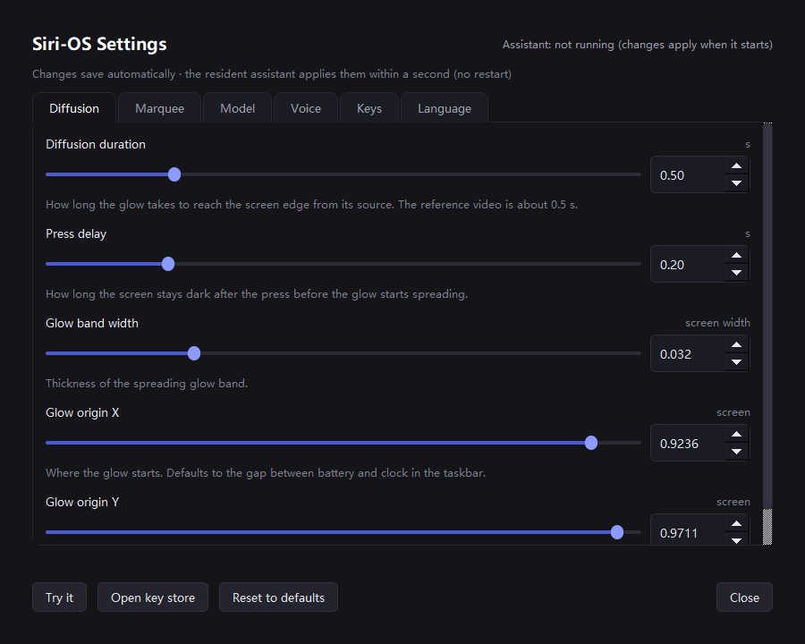

# Siri-OS · 桌面版第一代 Apple Intelligence

> 仿 iOS 18 / macOS Sequoia（2024）**第一代** Apple Intelligence 的桌面语音助手：
> **从你按下的那颗键径向炸开来的弥散虹彩边光** + 顶部对话卡 + 全屏鼠标穿透覆盖层。


<sub>从左到右：200 毫秒延迟期（整圈还是全黑）→ 波前飞行中 → 稳态（亮头沿边跑）。</sub>

<sub>与 Apple 无任何关联、未获背书。"Apple Intelligence" 与 Siri 是 Apple Inc. 的商标。
这是一个独立项目，靠逆向一段录屏做出来的致敬之作。</sub>

---

## 它能干什么

| | |
|---|---|
| **径向炸开** | 按下触发键 → 边光**先暗 200 毫秒** → 一道圆形波前从按钮位置炸开，扫到哪儿哪儿亮 |
| **顶部对话卡** | 屏幕顶部浮一张卡：状态点 + 状态字 + 回复正文。点一下可编辑，<kbd>Enter</kbd> 发送 |
| **离线听写** | Windows `System.Speech`（zh-CN / en-US），语音转文字这一步不联网 |
| **离线播报** | Windows SAPI 声线（中文 Huihui，英文 Zira / David），随回复语言自动切换 |
| **本地指令** | 时间 / 日期 / 音量 / 静音 / 搜索 / 打开程序 —— 本地直接答，不消耗模型 |
| **三层语言** | 界面语言、回复语言、听写语言**互相独立**（中文 / 英文 / 中英对照） |
| **配置热重载** | 改 `config.json` → 常驻助手 1 秒内自己生效，不用重启 |
| **图形化设置** | 6 个页签 31 个旋钮，由声明式 SPEC 自动生成，带后端可用性自检 |
| **量化自检** | 这份 README 里所有视觉结论都是**量出来的**，不是肉眼看的 —— 见[自检](#自检) |

---

## 快速上手

**环境要求：** Windows 10/11、Python 3.10+、一块有任务栏的屏幕。

```powershell
pip install -r requirements.txt
copy config.example.json config.json
```

填模型 key（只发给你自己的服务商，不经过任何第三方）：

```powershell
python set_key.py --deepseek              # 交互式，终端不回显，写完立刻发一次真实请求验活
```

跑起来：

```powershell
python siri_orb.py                        # 常驻助手（托盘图标）
python siri_orb.py --demo                 # 只看视觉效果：不碰麦克风、不问模型
python doctor.py --no-mic                # 7 段自检
```

**怎么唤醒：** 默认热键 `ctrl+alt+space`。如果你的笔记本有独立语音键（本项目就是围着一颗
小米 AI 键做的），绑定它：

```powershell
python keyprobe.py                        # 按那颗键，从日志里读扫描码
# 再填进 config.json 的 xiaomi_scan_code
```

---

## 视觉：参考视频里到底是什么

这个项目最难的不是"画一圈发光的边"，而是搞清楚**第一代 Apple Intelligence 的边光不是彩虹环**，
而且它**不是一圈在转**——它是一道**向外扩散的波前**，只是恰好住在屏幕边缘附近。

### 1. 是弥散边光，不是环

整个效果里**没有一条硬边线**。光从屏幕边界往里弥散，四角各有一团更热的斑，色相沿边缘平滑过渡：

| 锚点 | 实测色相 | 实测饱和度 |
|---|---|---|
| 右侧 | 0.64 – 0.68（蓝紫） | 0.36 – 0.59 |
| 底部 → 左侧 | 0.89 – 0.944（品红） | 0.63 – 0.90 |
| 顶部 → 右侧 | 0.76 → 0.02 | **掉到 0.26 – 0.44** |
| 右上角 | 0.067 – 0.094（橙） | 0.68 – 0.86 |

这些数字是**量出来的**，不是审美判断：用 OpenCV 逐像素分析 0.2 倍慢放的录屏，
沿边缘一圈采样 (hue, saturation, value) 得到。

两个很容易做错的推论：

- **角度必须按椭圆参数化**：先算 `nx = x/(W/2)`、`ny = y/(H/2)`，再 `atan2(ny, nx)`。
  直接用 `atan2(y, x)` 的话顶边色相几乎不变，整个边光会退化成"一圈彩虹环"。
- **插值必须走最短弧**：琥珀（0.06）→ 品红（0.90）线性插值会**穿过绿色**。
  实现里先把色相序列沿最短路径展开，再插值。

### 2. 配色是三个色池，不是彩虹

实测结构是**三个高饱和色池 + 低饱和过渡区**，不是连续色相扫过。
饱和度恒定在 ~0.82 的话，每次过渡都是一道满饱和彩虹横扫——这正是大多数复刻"看着不对"的原因。

所以实现里**色相和饱和度各走一条周期 PCHIP 样条**：每节点一个切线、相邻两段共用，
天然 C1 连续；局部极值处切线取 0，转折圆润且不会过冲。
（均匀 Catmull-Rom 在节点间距不均处会留下斜率断点——看上去就是拐点。）

### 3. 边光是径向炸开，不是转圈

参考视频的真实行为是：**按下 → 200 毫秒什么都没发生 → 圆形波前从按钮位置向外推 →
扫过的地方亮起来并且一直亮着。**

| 阶段 | 默认值 | 现象 |
|---|---|---|
| 按下 | 0 ms | 按钮亮起，**整圈边光仍然是暗的** |
| 延迟 | 200 ms | 什么都不发生（录屏里真的有这 0.2 秒） |
| 扩散 | 500 ms | 波前向外推，波前那一带最亮 |
| 稳态 | — | 整圈常驻，色相极慢漂移，一道亮头沿边跑 |

波前半径按 `ease = 1 - (1 - τ)^1.7` 推进。线性走（或者指数取 2.2）会让波前一冲而过；
1.7 是对着"右侧 2/3 已经亮起来"那一帧拟合出来的。

**延迟期必须给渲染器传 `radius = -1e9`。** 传 `None` 会走稳态分支，
**整圈边光在延迟期就全亮了** —— 这一下就把"先暗后炸开"整个抹掉，而且看起来还挺正常。
这是最容易踩的一个坑。

波源位置可配（`glow_origin`，归一化 xy）。默认 `[0.9236, 0.9711]` 落在
任务栏「电量图标」和「时钟」之间那道缝上，也就是触发键在本机的物理位置；
参考视频里 iPhone 侧边键的原始位置是 `[0.988, 0.25]`。

### 4. 两层，不是一层

单层 exp 衰减**做不到**"拖尾短"和"远处不黑"同时成立。渲染器拆成两层：

| 层 | 组成 | 作用 |
|---|---|---|
| 常驻底光 | `(ring + hot) * 0.45` | 一直有一层淡边光，扫完不会黑掉 |
| 行进波 | `ring * 0.75 + hot * 1.00` | 跟着波头走，带短拖尾和亮脊 |

### 5. 说话时边光往里钻

听写期间，边光的内渗深度跟着麦克风电平走：

```python
lvl         = clamp(level, 0, 1)
depth_scale = 1.0 + 0.95 * lvl     # 声音越大 -> 辉光钻得越深
bright      = 0.85 + 0.55 * lvl     # 同时整体更亮
fall        = exp(-max(d-1, 0) / (50.0 * depth_scale))
```

实测弥散长度 `L` 随电平从 **39.5 → 75.9 px**，与 `1 + 0.95·level` 的偏差 **≤1.5%**
（R² = 0.998 – 0.999）。

### 6. 一个看起来像审美问题、其实是算错的 bug

很长一段时间"颜色过渡不自然"。根因不是配色，是 **HSV → RGB 换算写错了**——三个中间量全错位：

```python
p = v * (1 - s)              # 原来是：np.zeros_like(v)
q = v * (1 - f * s)          # 原来是：v * (1.0 - s)
t = v * (1 - (1 - f) * s)    # 原来是：v * (1.0 - s * f)
```

这样渲染出来，蓝紫变成纯品红、橙变成橄榄黄——**颜色从第一版起就没对过**。
**定位方法比修法本身更值得记**：把"算法算出的期望 RGB"和"实际渲染出来的像素"逐点打印出来对。
肉眼看图定位不了换算错误，打印数字可以。

---

## 代码结构

```
siri_orb.py      常驻助手：全屏覆盖层 + 边光渲染器 + 对话卡 + 托盘
keyhook.py       全局键盘钩子：热键、扫描码绑定、按键日志
voice.py         离线听写（SAPI）+ 播报 + 本地系统指令（中英两套）
i18n.py          所有用户可见文案的唯一真源（中 / 英）
cfgstore.py      配置层：DEFAULTS + 声明式 SPEC + 原子读写
settings.py      图形化设置窗口（独立进程，托盘入口）
llm.py           模型后端：MiniMax(anthropic) / DeepSeek / 智谱(OpenAI)
keys.py          API key 仓库（不进版本库）
startup.py       守护进程：助手挂了自动重拉
install_autostart.py  当前用户级开机自启（不需要管理员权限）
```

### 设置面板



6 个页签 31 个旋钮，控件由 `cfgstore.SPEC` 自动生成 —— 加一个旋钮就多一个控件。

### 几个值得抄的设计

- **状态和文案走同一条原子信号**：`sig_ui(state, caption)`。分开发就会出现标签和正文错位。
- **覆盖层穿透、卡片不穿透**：覆盖层是全屏 `WindowTransparentForInput` 窗口，点击直达桌面；
  卡片是**另一个独立的小顶层窗口**，这样卡片能接收点击，而它周围一切照旧穿透。
- **设置面板做成独立进程**：助手没跑时也能打开，面板崩了不带走助手，还能双击 `.cmd` 启动。
- **热重载不只是重读 JSON**：LLM 对象是启动时建的，配置变了必须同时重建后端列表
  （`LLM.apply_config()`）；语音参数要读热重载后的快照，而不是启动时那份。
  配置文件写坏时**保持旧值**，不会回落默认值把 key、配色、开关全冲掉。
- **PyQt 面板"换语言"必须拆掉整棵控件树**：只对顶层布局项做 `setParent(None)`，
  **嵌套布局里的控件根本不在顶层项里**，它们会留下来继续画 —— 表现就是"中文按钮压在英文按钮上"。
  要拆的是容器，不是它的孩子。回归判据用控件数：重建前后按钮数不能增长。

---

## 三层独立的语言

| 层 | 配置键 | 取值 | 管什么 |
|---|---|---|---|
| 界面语言 | `ui_lang` | zh / en | 整个设置面板 + 覆盖层状态字 |
| 回复语言 | `reply_lang` | zh / en / **both** | 助手回答用哪种语言；both = 中英对照两段都显示 |
| 听写语言 | `stt.language` | auto / zh-CN / en-US | auto = 上次成功的语言优先，这次没听清换另一种再试 |

配置里的 `system_prompt` **刻意保持语言中性**。语言规则在请求时由 `i18n.LANG_RULES` 追加，
所以你自己写的那段提示词在三种回复语言下都照样生效。

播报声线跟着回复语言自动切（Huihui ↔ Zira / David）。中英对照模式下**只念一种语言**，
另一种只显示在卡片上，不重复念两遍。

---

## 配置

31 个旋钮全在 `config.json` 里，手改或用设置面板改都行。几个关键的：

| 键 | 默认 | 含义 |
|---|---|---|
| `hotkey` | `ctrl+alt+space` | 兜底热键 |
| `xiaomi_scan_code` / `xiaomi_vk` | `114` / `255` | 独立语音键的扫描码 / 虚拟键码 |
| `wave_delay_sec` | `0.2` | 按下到炸开的延迟 |
| `wave_sweep_sec` | `0.5` | 波前走完全屏的时长 |
| `wave_band_frac` | `0.032` | 行进光带宽度 |
| `glow_origin` | `[0.9236, 0.9711]` | 波源位置（归一化 xy） |
| `marquee_period_sec` | `6.0` | 亮头跑一圈几秒 |
| `marquee_trail` | `0.09` | 拖尾长度（占一圈的比例） |
| `caption_position` | `top` | 对话卡在顶部还是底部 |
| `show_orb` | `false` | 中心光球**默认关** —— 参考视频里没有中心光晕 |
| `level_source` | `mic` | `mic` 或 `sim`（模拟音节包络，麦克风坏了也能演示） |
| `ui_lang` / `reply_lang` | `zh` / `zh` | 见上 |
| `llm.order` | `minimax, deepseek, zhipu` | 后端优先级 |

**API key 不进 `config.json`。** 统一放 `config/api_keys.json`（已 gitignore），
也可以用环境变量 `SIRI_OS_KEYS` 指到别处。

```json
{ "minimax": "sk-...", "deepseek": "sk-...", "zhipu": "id.secret" }
```

也可以把 `MINIMAX_GATEWAY_CFG` 指到一个带 `minimax: apiKey:` 的 yaml，MiniMax 后端会从那里取 key。

某个后端返回 401 / 402 / 403（鉴权或余额类）会被**在本次进程内拉黑** ——
不然每句话都要先白撞一次失败的请求，在语音助手里那是能感觉到的延迟。
LLM 对象全进程共用，拉黑状态才能跨按键保留。

---

## 自检

上面那些视觉结论都是量出来的，仓库里带着量它们的工具：

| 工具 | 量什么 |
|---|---|
| `doctor.py` | 7 段自检：依赖 → 配置 → 渲染 → 音频 → 麦克风 → 模型 → 常驻进程 |
| `i18n_check.py` | 323 项断言：文案双语齐全、提示词语言中性、面板重建不残留孤儿控件 |
| `preview.py` | 离线渲染边光（合成背景，不碰你的桌面） |
| `palette_check.py` | 样条取值 + 边缘采样配色 |
| `trail_check.py` | 波前背后的亮度剖面 —— 证明拖尾是平的，不是一条长尾 |
| `level_check.py` | 弥散长度 vs 电平（最小二乘拟合） |
| `level_live.py` | 同样的测量，但打在真实运行的助手上 |
| `marquee_check.py` | 一圈几秒 + 尾巴角度（离线和实机两版） |
| `frame_lit.py` | 按到波源的距离分环量增益 —— 波前真的在推进的硬证据 |
| `wave_capture.py` | 实机连拍整个扩散过程 |
| `ref_measure.py` | **从你自己的一段参考录屏**里提取配色和波前剖面 |
| `verify_live.py` | 逐帧卡片亮度、边带亮度 + 变化热力 ASCII 图 |

```powershell
python doctor.py --no-mic
python i18n_check.py
python preview.py out 0.0 0.4 1.0 2.0
```

**波前"真的在推进"是怎么证明的。** 不能用 alpha 直接定位波前：常驻底光会把它压到 1.0，
`argmax` 只会取到第一个饱和环，看起来就像波前卡住不动了。
正确做法是**相邻帧增量法**——用相邻两帧相减把常驻底光抵消掉，剩下的就是这一帧新点亮的。
把扫描时间临时拉到 2.5 秒慢放抓帧，实测波前 **750 → 900 → 1300 → 1600 px** 单调推进，
且增益最高的一环永远是波前所在的那一环。

**量"往里钻"的两个坑（代码里都写了注释）：**

1. **不能沿边线量**——沿边线量到的是整圈边光，不是钻入深度，要沿每个边的**法线方向**做指数拟合。
2. **实机必须先减背景** —— 否则底下的窗口内容会把拟合污染掉。

---

## 排障

**`doctor.py` 报麦克风电平恒为 0。**
有些笔记本（本机刷机后就是）会整个丢掉 Intel SST / DMIC 采集链路：
设备在、不静音、权限对，但驱动就是不送样本。
SAPI `AudioLevel`、winmm `waveIn`、WASAPI `IAudioClient::Initialize` 三条独立采集路全挂，
而播放链路完全正常 —— **这是驱动层的问题，不是应用的问题。**
按代价从低到高：

1. 插一个带麦的耳机，选成默认输入；
2. 装 OEM 音频驱动 + 升 BIOS；
3. 关掉采集侧的 APO（声音控制面板 → 录制 → 麦克风阵列 → 属性 → 增强功能 → 全不勾）。

在那之前可以用 `level_source: "sim"` 演示，听写链路也能照常跑。

**某个后端报 402 `insufficient_balance`。** key 是有效的，是账户没钱。充值后重启助手即可 ——
拉黑状态是按进程算的。

---

## 出处

边光几何是用 OpenCV 逐像素分析第一代 Apple Intelligence 的 0.2 倍慢放录屏逆向出来的；
层结构（四条方向性 inset 影 + 第五层白雾，blur 110 / spread −60 / 18%）
则对照第三方公开复刻源码（RationalGo《Apple Intelligence Glow Effect With AI》）做了静态分析交叉验证。
本仓库**不含任何 Apple 的代码或素材**。

## License

MIT —— 见 [LICENSE](LICENSE)。
